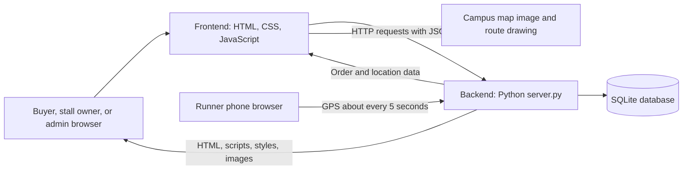

# BiteHub System Reviewer

## 1. What is BiteHub?

BiteHub is a web application for food ordering at **Palawan National School (PNS)**. It gives the school community one place to find stall products, place and follow orders, and gives stall owners and school administrators tools to manage campus food service.

The application has three main user areas:

- **Buyer / customer:** browses stalls and food, adds items to a bag, places pickup or delivery orders, and checks order progress.
- **Stall owner:** manages a stall profile, opening hours, menu items, stock, and incoming orders.
- **School admin:** oversees stalls, school activity, reports, and platform settings.

For delivery, a stall owner can enter the runner's name. A runner can share location for that order using a secure link; the runner does not need to create a BiteHub account for that sharing flow. The current code also retains some runner-account support for compatibility.

## 2. How the system is put together



### Typical order flow

1. The browser loads the page shell and its CSS, JavaScript, and image assets.
2. `app.js` asks the Python server whether the user has a valid session and requests the data needed for the screen.
3. The buyer chooses a stall and products. The browser sends the order request to the server.
4. Python checks the request and permissions, applies order and stock rules, and saves the result in SQLite.
5. The stall owner sees the order and updates its status. The buyer can refresh the order view to see progress.
6. For delivery, the runner opens an order-specific sharing link and allows the phone browser to provide GPS. BiteHub sends those coordinates to the server and displays them on the PNS map for the buyer.

The campus route is drawn from a local map image and a hand-traced graph of the blue walkways. It is a campus route preview, not an external turn-by-turn navigation service. Actual phone GPS requires HTTPS and the runner's permission.

## 3. Frontend and backend

### Frontend: the part people use

The frontend runs in the user's browser.

- `index.html` provides the main page structure, navigation/sidebar, dialogs, opening screen, and the area where each view is rendered.
- `app.js` handles clicks and forms, changes screens, talks to the server, and renders products, orders, maps, and role dashboards.
- The CSS files control colors, typography, layout, animation, and responsive layouts for different screen sizes. `palette-theme.css` is loaded last, so its rules can refine earlier styles.
- `assets/` holds the BiteHub and school branding, campus maps, and other images.
- `manifest.webmanifest` describes the installable web app to supported browsers. `sw.js` handles web-push notification events and notification clicks.

### Backend: the part that processes the work

`server.py` is the Python backend. It receives browser requests, checks sign-in and user permissions, validates values, applies ordering rules, reads and writes data, and sends a response. It also serves the frontend files.

The browser and server communicate over HTTP. Most interactive data is sent as JSON. The browser is responsible for displaying the interface; the server is responsible for enforcing the important rules and saving the official application data.

### Database: saved application data

BiteHub uses SQLite. The main database tables include:

| Table | What it stores |
| --- | --- |
| `users`, `sessions` | Accounts and signed-in sessions |
| `schools` | School location and delivery settings |
| `stalls`, `products` | Stall profiles and menu items |
| `orders`, `order_items` | Orders and the products in each order |
| `delivery_positions` | Most recently shared runner location |
| `feedback`, `reach_views` | Customer feedback and menu reach counts |
| `settings`, `push_subscriptions` | App settings and notification subscriptions |

SQLite is a file-based database, which is convenient for a school prototype and local development. A free Render web service does not provide a persistent disk by default, so its local database file can be lost when the service restarts or redeploys. A persistent database is needed before relying on a hosted version for real accounts or orders.

## 4. Important code functions

### Browser code in `app.js`

| Function | Simple explanation |
| --- | --- |
| `boot()` | Starts the app. It checks whether the page is a normal BiteHub page or a runner sharing page, then loads the session and first screen. |
| `api(path, options)` | Sends a request to the Python server and reports a useful error if the server rejects it. |
| `refresh()` and `startAutoRefresh()` | Load current app data and periodically refresh order information. |
| `renderBuyer()`, `renderOwner()`, `renderAdmin()` | Build the main screen for each user area. |
| `addToCart()` and `orderAction()` | Update the buyer's bag and handle order-related actions. |
| `mapXY()` and `mapLatLon()` | Convert between map pixels and campus latitude/longitude coordinates. |
| `nearestWalkProjection()` and `campusRoute()` | Find nearby marked walkway points and calculate a route across the traced campus path graph. |
| `sendAnonymousRunnerPosition()` | Reads the runner phone's GPS position and sends it to the server for the active order. |
| `startAnonymousRunnerSharing()` | Starts location sharing and repeats it about every five seconds while the page stays open. |

### Server code in `server.py`

| Function or class | Simple explanation |
| --- | --- |
| `connect()` | Opens a connection to the SQLite database. |
| `initialize()` | Creates the database tables and applies needed schema updates. |
| `Handler` | Receives HTTP requests and routes them to the right server behavior. |
| `do_GET()`, `do_POST()`, `do_PATCH()`, `do_DELETE()` | Handle the main kinds of web requests: read, create/send, update, and delete. |
| `password_digest()` | Derives a protected password representation for account verification rather than saving a plain-text password. |
| `clean_text()` and other parsing helpers | Check and normalize user input before the server uses it. |
| `campus_point()` | Checks that a delivery or school location is within the allowed campus area. |
| `create_admin()` | Creates an administrator account through the server's setup path. |

Examples of API paths include `/api/session` for the signed-in session, `/api/products` for menu products, `/api/orders` for order data and actions, and `/api/runner-location` for runner location updates.

## 5. Languages and file types, explained simply

People often call all the code-related files “programming languages,” but they have different jobs. BiteHub uses programming languages, markup and styling languages, a database query language, and data/configuration formats.

### The main languages

| Name | Full name / meaning | Where BiteHub uses it | What it does |
| --- | --- | --- | --- |
| **HTML** | HyperText Markup Language | `index.html` | Describes what is on the page and how it is grouped: headings, buttons, forms, dialogs, and content areas. HTML is markup, not the logic that processes an order. |
| **CSS** | Cascading Style Sheets | The `.css` files, including `palette-theme.css` | Controls how the page looks: colors, fonts, spacing, alignment, responsive layouts, and animation. If HTML is the frame of a house, CSS is the paint, room layout, and decoration. |
| **JavaScript** | A programming language; its name is not an acronym | `app.js` and `sw.js` | Makes the browser interactive. It handles clicks, changes screens, calls the API, updates the bag and order view, draws the map route, and receives push-notification events. In this project, JavaScript mainly runs in the browser. |
| **Python** | A general-purpose programming language | `server.py` and `generate_local_cert.py` | Runs the backend. It receives requests, checks accounts and permissions, validates order information, applies business rules, uses the database, and sends responses. |
| **SQL** | Structured Query Language | SQL statements inside `server.py` | Tells a database to find, add, change, or remove records. For example, the server can look up the products for a stall or save a new order. SQL is a query language, not the database itself. |

### Other formats and tools in the project

| Name | Is it a programming language? | What it does in BiteHub |
| --- | --- | --- |
| **SQLite** | No. It is a database engine. | Stores structured BiteHub records in a database file. Python sends SQL commands to SQLite. |
| **JSON** (JavaScript Object Notation) | No. It is a data format. | Packages information for the browser and server to exchange, such as a product, order, or location. |
| **YAML** (often expanded as “YAML Ain't Markup Language”) | No. It is a configuration format. | `render.yaml` tells Render what kind of service to create and which commands to run. |
| **SVG** (Scalable Vector Graphics) | Not a programming language. It is a vector-image format written with XML-like markup. | `bitehub-mark.svg` describes the BiteHub icon as shapes that stay sharp when resized. |
| **HTTP** (Hypertext Transfer Protocol) | No. It is a communication protocol. | Carries requests and responses between the browser and Python server. |
| **Git / GitHub** | Neither is an app language. Git tracks code changes; GitHub hosts the Git repository online. | Git records versions of the BiteHub code. Render can watch the GitHub repository and deploy a pushed update. |
| **Render** | No. It is a hosting platform. | Runs the Python server and makes the website available at a public web address. |

### A tiny example of how they work together

The examples below are simplified to show the jobs of each part:

```html
<button class="button-primary">Browse food</button>
```

HTML puts a button on the page and gives it a CSS class.

```css
.button-primary {
  background: #226c82;
  color: white;
}
```

CSS makes that button teal with white text.

```javascript
const products = await api("/api/products");
```

JavaScript asks BiteHub's server for the product list.

```python
db = sqlite3.connect(DB_PATH)
```

Python opens the BiteHub database so the server can read or save records.

```sql
SELECT name, price_cents FROM products;
```

SQL tells SQLite which product information to retrieve.

The server can return the result as JSON, for example:

```json
{"name": "Chicken rice bowl", "price_cents": 7500}
```

JavaScript reads that data and displays the product card in the browser. In short: **HTML describes it, CSS styles it, JavaScript makes it interactive, Python processes it, SQL asks for stored data, and SQLite stores that data.**

**Frontend** means the code that runs in the browser and presents the app. **Backend** means the code on the server that processes requests and protects the data. **API** is the set of agreed request paths and data formats the frontend uses to ask the backend to do work.

## 6. How BiteHub is published with Python and Render

Python is the language that runs BiteHub's backend. Render is the hosting service that starts that Python server on the internet. GitHub stores the project code and can tell Render when a new version is ready.

### What `render.yaml` tells Render

The current configuration defines a Python web service named `bitehub`:

```yaml
buildCommand: python -m py_compile server.py
startCommand: python server.py --host 0.0.0.0 --port $PORT --behind-proxy
```

- The **build command** asks Python to compile-check `server.py`, catching Python syntax errors before startup.
- The **start command** launches the BiteHub server, listens on the port Render provides in `$PORT`, and uses `--behind-proxy` because Render handles public HTTPS before forwarding requests to Python.
- `requirements.txt` lists the optional `cryptography` package used for web-push support. Core ordering features use Python's standard library.

### First deployment

1. Save the code changes and push the project to its GitHub repository.
2. Sign in to Render and choose **New → Blueprint**.
3. Connect the BiteHub GitHub repository and select the branch to deploy. This repository currently uses `master`.
4. Render reads `render.yaml`, builds the service, and runs the Python start command.
5. When the service reports **Live**, open the Render URL and check the login page, menu, and order flow.

### Publishing later updates

1. Make and save the code changes locally.
2. Commit the changes and push them to the connected GitHub branch, for example:

   ```powershell
   git add -A
   git commit -m "Describe the update"
   git push origin master
   ```

3. If automatic deploys are enabled, Render sees the new commit and starts another build and deployment. Otherwise, open the service in Render and choose **Manual Deploy** for the connected commit.
4. Wait until Render reports **Live**, then open the hosted app and verify the updated feature.

Pushing code to GitHub does not by itself prove that the Render deployment succeeded. Confirm the deployment state in Render and load the hosted site. Keep the local demo server and the public Render service distinct: `localhost` is only available on the local computer.

## 7. Useful presentation answers

**What problem does BiteHub solve?**  
It organizes school-stall menus and food orders in one place, so students and other members of the PNS community can find food and follow their orders more easily.

**How do the frontend and backend work together?**  
The browser displays the app and sends requests. The Python server checks each request, applies the rules, reads or updates SQLite, and returns data for the browser to show.

**Why use Python?**  
Python runs the backend logic and provides a readable way to handle web requests, validation, and database work.

**Why use SQLite?**  
It is simple to set up and works well for a local prototype because the database is stored in a file. A persistent hosted database is a better choice for dependable real-world use.

**What does Render do?**  
Render runs the Python web server on a hosted machine and provides a public web address. The repository's `render.yaml` supplies the build and start instructions.

**Does the campus map give live delivery tracking?**  
The runner's phone can share GPS through an order-specific link, and BiteHub updates the map while sharing is active. The route is traced from the campus map's marked paths, so it is a campus guide rather than a guaranteed road-navigation service.

## 8. Short explanation to present aloud

“BiteHub is a food-ordering web app designed for Palawan National School. The frontend uses HTML for page structure, CSS for design, and JavaScript for interactions. The backend is written in Python and handles accounts, menus, orders, and delivery updates. SQLite stores the app's data. The browser and server communicate through HTTP requests with JSON data. We publish the app by pushing the code to GitHub; Render reads `render.yaml`, checks and starts the Python server, and hosts the site at a public URL. The campus delivery map uses marked school paths and can display a runner's shared phone location.”

## 9. What the main project files do

### What is a repository?

A **repository**, often shortened to **repo**, is the project's folder together with Git's saved history of changes. BiteHub's local repo is the folder you work in on your computer. The GitHub repo is the online copy of that project. It holds code and assets; it does not run the website by itself.

When you **commit**, Git saves a named checkpoint of selected changes. When you **push**, Git sends those commits to GitHub. Render can then read the GitHub repo and run the app. So the chain is: **your project folder → Git commit → GitHub repository → Render build and running website**.

### Main files and folders

| File or folder | What it does | How it connects to BiteHub |
| --- | --- | --- |
| `index.html` | Main page shell: metadata, app area, dialogs, sidebar, CSS links, and JavaScript script tag. | The browser opens this first. Its `<link rel="stylesheet">` tags load the CSS files and its `<script src="app.js">` tag loads the browser logic. |
| `app.js` | Main browser application: sign-in views, buyer/owner/admin screens, bag, orders, API calls, campus map, and page navigation. | It uses `fetch()` through the `api()` helper to send HTTP requests to `server.py`, then puts the returned information on the page. |
| `server.py` | Python web server, API, input checks, sign-in and permission checks, order rules, and database operations. | The browser sends it requests. It returns page files or JSON data. It uses SQLite to keep application records. |
| `styles.css` | Base colors, fonts, buttons, page layout, and shared components. | `index.html` loads it before the more specific stylesheets. |
| `app-ui.css` | Main app shell, header, workspace, dashboard, and common interface components. | Styles the logged-in areas that `app.js` renders. |
| `experience.css` | Keyboard focus, interaction details, and delivery map styling. | Makes controls easier to use and styles map/route displays. |
| `school-theme.css` | Sign-in page and role-choice presentation. | Styles the account entry screens before the user enters a dashboard. |
| `feature-ui.css` | Product, bag, checkout, and runner-assignment features. | Styles specific interaction areas inside the app. |
| `stall-profile.css` | Stall profile and stall-specific product presentation. | Styles the stall pages opened from the menu. |
| `market-ui.css` | Role workspaces, tabs, and food-market browsing layouts. | Keeps browsing and dashboard areas organized and responsive. |
| `brand-refresh.css` | Brand logo, wordmark, and branding refinements. | Applies visual branding to the shared BiteHub interface. |
| `opening-screen.css` | Animated BiteHub opening/loading screen. | Styles the first visual shown while the browser starts the app. |
| `sidebar-preferences.css` | Slide-out sidebar, settings, theme, sound, and account preferences. | Styles account navigation and user preference controls. |
| `device-responsive.css` | Layout changes for phones, tablets, and narrower windows. | Helps the same screens fit different device sizes. |
| `palette-theme.css` | Final pastel palette and refinements to shared screens. | It is loaded last, so its matching style rules can override earlier colors and appearance rules. |
| `sw.js` | Service worker for push notifications and notification clicks. | The browser runs it separately from the visible page to handle supported notification events. |
| `manifest.webmanifest` | App name, icon, start page, and install/display preferences. | Helps supported browsers offer BiteHub as an installable web app. |
| `bitehub.sqlite3` | Local SQLite database file. | Stores records during local development. It is data, not the Python code that operates on the data. |
| `assets/` | Logos, school photos, map images, and other visual files. | HTML, CSS, and JavaScript refer to these paths so the browser can display them. |
| `requirements.txt` | List of optional Python packages. | Tells a Python setup which extra packages, such as `cryptography` for web push, may be needed. |
| `render.yaml` | Render service name, build command, and start command. | Render reads it to know how to build and start the Python backend. |
| `start.ps1`, `start-secure.cmd` | Local launch helpers for starting BiteHub on a computer. | Convenient for local development; they are separate from Render's `startCommand`. |
| `generate_local_cert.py` | Python helper to create a local development HTTPS certificate. | Helps test browser features such as GPS locally; it does not deploy or host the public website. |
| `README.md` | Project instructions and limitations. | Explains setup, local use, and deployment notes to developers. |
| `fullframework.drawio` | Editable system-flow diagram. | Shows a visual view of the app's roles and data flow; it is documentation, not running application code. |

### How these files connect to make the website

1. A browser opens the website address. On a local computer that may be `http://127.0.0.1:8000`; a hosted Render app has its own public URL.
2. The web server returns `index.html`. The browser reads it and loads its linked CSS, JavaScript, logo, and other assets.
3. `app.js` draws the correct screen and reacts when someone clicks a button or submits a form.
4. If it needs products, orders, or account information, JavaScript requests an `/api/...` address on the same website. This is how it connects to the backend.
5. `server.py` receives the request, checks it, and reads or updates SQLite through SQL. It sends a response, usually JSON, back to the browser.
6. JavaScript uses that response to redraw the page. For example, after an order is saved, it can show that order in the buyer's order list.

### How the repository connects to the hosted website

The repository is the source that Render deploys. After code is committed and pushed to the GitHub branch connected to Render, Render reads `render.yaml`, runs its build command, then starts the Python server with the configured start command. Render hosts that server and gives the website a public URL. The local `localhost` preview and the public Render website are separate places: changes appear on the public site after its Render deployment completes.

