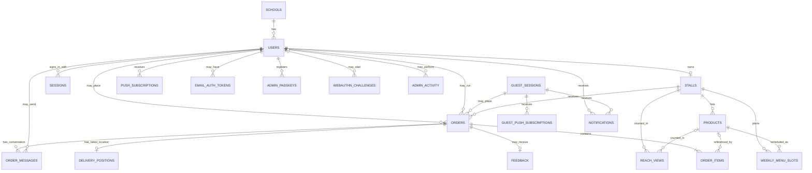

# BiteHub database, in plain language

This guide describes the private PostgreSQL schema used by BiteHub's Python server. The tables live in **`bitehub_app`**. Older tables in **`public`** are separate and are not the tables used by the current BiteHub app.

## Where to look in Supabase

1. Open the intended project: **BiteHub-Dev** for development, or the separate MakuKira project for Production.
2. Open **Table Editor** and choose the **`bitehub_app`** schema in its schema selector.
3. Start with `orders`, `order_items`, `stalls`, `products`, and `users` to understand the main app flow. Table and selected column descriptions are added by `202611140002_plain_language_schema_comments.sql`.

Keep `bitehub_app` private and out of the Data API exposed-schema list. The website and mobile app use the BiteHub server; they must not connect to PostgreSQL directly. Supabase documents that custom schemas need to be explicitly exposed and granted before they become available through the Data API, and BiteHub intentionally does not do that. See [Supabase custom schemas](https://supabase.com/docs/guides/api/using-custom-schemas).

> The migration set defines up to 22 BiteHub tables. Optional features may mean a project has fewer until their migrations are applied. This guide covers the full schema represented by the repository, not a live inventory of either Supabase project.

## The big picture



`settings` is the server's key/value control table. `school_requests` is a legacy table kept for compatibility; it is not part of the normal current app flow. Some relationships are deliberately optional: guests do not need user accounts, guest feedback has no `buyer_id`, and deleted products stay available to old orders through the saved order-item details.

## Tables by job

| Area | Tables | What they mean |
| --- | --- | --- |
| School and accounts | `schools`, `users`, `sessions` | PNS directory, registered staff/admin/stall accounts, and signed-in sessions. Passwords are stored as salted hashes. |
| Stalls and menu | `stalls`, `products`, `weekly_menu_slots` | Stall profile/open state, food catalog, stock, price, dietary details, and repeating menu plans. |
| Ordering | `orders`, `order_items`, `feedback` | Each checkout, the food/price snapshot bought, and an optional review. Guests are represented by `guest_sessions`, not fake customer accounts. |
| Delivery and conversation | `delivery_positions`, `order_messages` | Latest courier location and the private guest/buyer-to-stall conversation for an order. |
| Alerts | `push_subscriptions`, `guest_push_subscriptions`, `notifications` | Device subscriptions and in-app alerts for signed-in users or guest sessions. |
| Sign-in security | `email_auth_tokens`, `admin_passkeys`, `webauthn_challenges` | Temporary hashed email-verification/reset tokens and school-admin passkey challenge data. |
| Admin and analytics | `admin_activity`, `reach_views`, `settings` | Admin change history and restore data, privacy-preserving view counts, and server controls. |
| Legacy compatibility | `school_requests` | Retained request records from the older local schema; not used by the current main workflow. |

## Follow the most common flows

### Guest places an order

`guest_sessions` → `orders` → `order_items`

The guest session has a generated ID, display name, hashed browser token, and expiry. The order keeps the guest's school-role/grade/section and fulfillment details. Each `order_items` row saves the item name and price at checkout, so an old receipt still makes sense if the product later changes or is archived.

### Stall owner publishes food

`users` → `stalls` → `products`

An owner account is a row in `users`; its stall profile is in `stalls`; each menu item is in `products`. `price_cents` is the price in cents (for example, ₱25.00 is `2500`). `stock_count` may be `NULL` for untracked stock. `available` means the owner has made it orderable; `deleted_at` means an admin archived it.

### Admin removes something and may restore it

`admin_activity` records who did what and when. A removed stall is soft-deleted through its owner account; a removed product gets `products.deleted_at`. The product row and old orders are retained so restoration/history can work. The activity record's target is intentionally not a foreign key, because a removed target still needs an audit entry.

### Owner and guest communicate

`orders` → `order_messages`

Messages belong to a specific order. The server verifies that the sender controls that order before it returns or saves a message.

## Sensitive data at a glance

- `users.password_hash` and `users.password_salt` are credential-verification data, not plaintext passwords.
- `sessions.token_hash`, `guest_sessions.token_hash`, and the guest/runner access-token hash fields are hashes of bearer tokens. The raw cookie/share token should not be stored in these columns.
- `delivery_positions` holds precise location data. Keep access limited and retain it only as long as the delivery feature needs it.
- `push_subscriptions.subscription_json` and guest push subscriptions contain device endpoint/key material. Keep them private.
- Photo fields (`*_data`, `*_type`) store image bytes and their media type in the current compatibility schema.
- `bitehub_app` is private; the trusted Python backend is the application boundary. Row Level Security stays enabled, and browser roles should not receive direct table access.

## Quick read-only SQL for the Supabase SQL Editor

List BiteHub tables and their descriptions:

```sql
SELECT table_name, obj_description(format('%I.%I', table_schema, table_name)::regclass, 'pg_class') AS description
FROM information_schema.tables
WHERE table_schema = 'bitehub_app' AND table_type = 'BASE TABLE'
ORDER BY table_name;
```

Show a table's columns and their descriptions (replace `orders` if needed):

```sql
SELECT column_name, data_type, is_nullable,
       col_description(format('%I.%I', table_schema, table_name)::regclass, ordinal_position) AS description
FROM information_schema.columns
WHERE table_schema = 'bitehub_app' AND table_name = 'orders'
ORDER BY ordinal_position;
```

See which food is on each stall menu:

```sql
SELECT s.name AS stall, p.name AS food, p.price_cents, p.available, p.stock_count
FROM bitehub_app.stalls AS s
JOIN bitehub_app.products AS p ON p.stall_id = s.id
WHERE p.deleted_at IS NULL
ORDER BY s.name, p.name;
```

These are inspection queries only; they do not modify rows.

## What the descriptions migration changes

`202611140002_plain_language_schema_comments.sql` adds PostgreSQL `COMMENT` metadata to the schema, tables, and key columns that exist. It does not rename tables, alter permissions/RLS, add columns, or change records. It safely skips optional tables/columns that are not present yet. Re-run it after adding a future optional table if you want its descriptions applied too.
